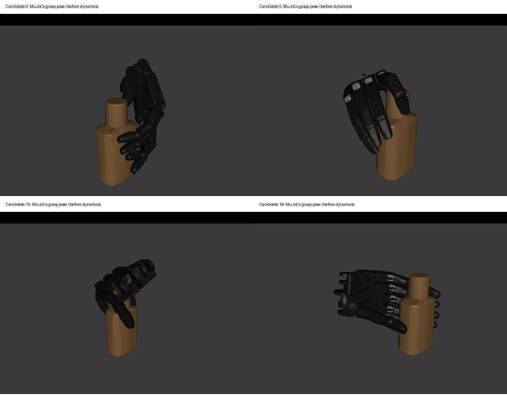

# Shadow control on the Sharpa smoke object

The existing Shadow right hand succeeds on 20/20 candidates on the same bottle
scene where the final Sharpa batch succeeded on 1/20. Both batches use 20 seeds,
surface initialization, the seed-123 sampling wrapper, and the unchanged
`right_full` tabletop evaluator. No Shadow robot/manipulation configuration or
evaluation thresholds were modified.

| Metric | Shadow control | Sharpa final |
| --- | --- | --- |
| Attempted / evaluated | 20 / 20 | 20 / 20 |
| Physical lift success | 20 / 20 | 1 / 20 |
| All three command stages within joint limits | 18 / 20 | 2 / 20 |
| Cases with static grasp contacts | 20 / 20 | 10 / 20 |
| Numerical warnings | 0 | 0 |
| BODex optimizer success flags | 0 / 20 | 0 / 20 |

The optimizer flags are not a physical-success measure: the Shadow control also
reports zero despite passing every physical lift test. Their convergence/feasibility
definition warrants separate investigation before using them as a quality gate.
Two Shadow squeeze targets exceed limits under the unchanged BODex extrapolation
rule; no targets were clipped to improve these results.

This single-scene comparison supports investigating Sharpa geometry/contact,
initialization and control calibration. It does not establish a general hand
ranking or isolate which Sharpa parameter causes the difference. Hand-specific
initial postures, transfers, collision models, tendon coupling and controllers
are intentionally those of each hand. Identical seeds do not make corresponding
candidate IDs identical physical grasps across different kinematics.

The scene is `core_bottle_1071fa4cddb2da2fc8724d5673a063a6/tabletop_ur10e/scale008_pose004_0`,
actual scale 0.081, with exactly the same object pose as the final Sharpa run.
The physical evaluator uses the same density policy, friction, external load,
100 mm lift, 50 mm translation-error and 15 degree rotation-error thresholds.



## Outputs

Workspace directory: `benchmarks/shadow_bottle_control/`.

- `comparison.json`: per-candidate metrics for both hands, including joint limits.
- `configs/` and `resolved_synthesis.yaml`: pre-solve configuration snapshots.
- `solver_result.npz`, `solver_summary.json`: actual optimizer outputs.
- `output/sim_shadow/tabletop_full/shadow_smoke/graspdata/`: raw BODex outputs.
- `bench/shadow_smoke_right_full_shadow/`: converted data, evaluation outputs,
  resolved evaluation configuration, contact diagnostics and candidate image.
- `logs/`: synthesis, conversion, rendering, evaluation and preview checks.

## Reproduction

The existing Sharpa-named diagnostic/preview scripts now also accept `hand=shadow`
or `sim_shadow.yml`. Only these wrappers changed; the Shadow pipeline is unchanged.

```bash
export HUGS_DATASET_ROOT=/home/hao-fang/hugs-dataset
export HUGS_OBJECT_ROOT=/home/hao-fang/hugs-dataset/object
export SMOKE_DIAGNOSTIC_DIR=/home/hao-fang/hugs-workspace/benchmarks/shadow_bottle_control
export HUGS_OUTPUT_ROOT="$SMOKE_DIAGNOSTIC_DIR/output"

cd /home/hao-fang/hugs-workspace/HUGS-BODex
.venv/bin/python scripts/run_sharpa_smoke.py task=synthesis name=shadow_smoke \
  manip_cfg_file=sim_shadow/tabletop_full.yml task.suite_config=sim_shadow.yml \
  'task.grasp_types=[3_right_full]' \
  task.scene_source.manifest_path=/home/hao-fang/hugs-workspace/benchmarks/sharpa_phase2_final/scenes.txt \
  task.parallel_world=1 n_worker=1

cd /home/hao-fang/hugs-workspace/HUGS-DexGraspBench
.venv/bin/python src/main.py task=format hand=shadow exp_name=shadow_smoke_right_full \
  save_root="$SMOKE_DIAGNOSTIC_DIR/bench" task.data_name=BimanBODex \
  task.data_path="$HUGS_OUTPUT_ROOT/sim_shadow/tabletop_full/shadow_smoke/graspdata" n_worker=1
MUJOCO_GL=egl .venv/bin/python scripts/render_sharpa_smoke.py task=eval hand=shadow \
  exp_name=shadow_smoke_right_full save_root="$SMOKE_DIAGNOSTIC_DIR/bench" n_worker=1
# Inspect diagnostics/candidate_mujoco.png before evaluation.
MUJOCO_GL=egl .venv/bin/python scripts/evaluate_sharpa_smoke.py task=eval hand=shadow \
  exp_name=shadow_smoke_right_full save_root="$SMOKE_DIAGNOSTIC_DIR/bench" \
  task.start=0 task.end=20 n_worker=1
```

For browser preview, forward local port 8081 to server loopback port 8081, then run:

```bash
cd /home/hao-fang/hugs-workspace/HUGS-DexGraspBench
HUGS_DATASET_ROOT=/home/hao-fang/hugs-dataset \
.venv/bin/python scripts/preview_sharpa_poses.py task=eval hand=shadow \
  exp_name=shadow_smoke_right_full \
  save_root=/home/hao-fang/hugs-workspace/benchmarks/shadow_bottle_control/bench \
  task.viewer.port=8081 +preview_stage=grasp
```

Open `http://localhost:8081` on the client computer. The browser controls select
candidate 0–19 and pregrasp/grasp/squeeze without stepping physics.
