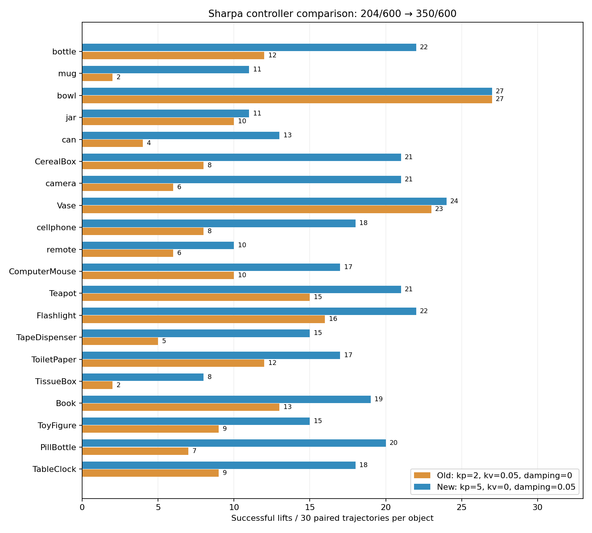

# Sharpa 控制器擴大配對測試

後續正式右手 kp 已提升至 7.5，kv=0、關節阻尼=0.05；同一批 600 組成功
350→384。見 [kp=7.5 報告](../sharpa_kp7p5_validation/README.md)。本文保留 kp=5
採用時的歷史測試紀錄。

**完成 600 組配對、1,200 次模擬：抬升成功 204/600（34.0%）→
350/600（58.3%），增加 24.3 個百分點。146 組失敗轉成功，0 組成功轉失敗。**

20 類物件中 19 類改善、1 類（bowl）持平。只看新增的 17 類、排除 bottle／mug／
camera，仍從 184/510（36.1%）提高至 296/510（58.0%）。因此這次改善也出現在
前輪三類物件以外。這批重新生成的 grasp 與小測試 30 組不同，不能把兩輪成功率
直接相減當成規模效應；應使用各輪內完全相同軌跡的配對差。

## 結果

| 指標 | 原設定 | kp=5、kv=0、damping=0.05 |
|---|---:|---:|
| 抬升成功／全部候選 | 204/600（34.0%） | **350/600（58.3%）** |
| 成功且三階段目標皆在限位內／全部候選 | 170/600（28.3%） | **295/600（49.2%）** |
| 僅在 469 個目標合法候選中計算成功率 | 170/469（36.2%） | **295/469（62.9%）** |
| MuJoCo 警告／非有限狀態 | 0／0 | 0／0 |
| 初始穿透拒絕 | 0 | 0 |
| 曾達 actuator 力矩上限 99% 的候選 | 2 | 1 |
| 最大動態手物穿透 | 3.512 mm | 5.773 mm |
| 各候選峰值手物穿透的第 95 百分位 | 1.871 mm | 2.400 mm |
| 最大動態自碰撞穿透 | 7.277 mm | 7.277 mm |
| 最大實際軟限位超出量 | 0.033795 rad | 0.037578 rad |
| lift 最後 200 ms 五指法向力總和的候選中位數 | 0 N | 6.940 N |

全部 1,200 次評估各跑完 750 steps，共 900,000 steps。600 個配對的輸入 SHA-256、
目標合法性、物體質量一致；逐步軌跡、評估檔、預定候選數及數值有限性全部通過稽核。
生成約 192 秒、配對重播約 99 秒（4 個 CPU 程序），另加轉換、格式化與彙總。
全部 1,800 個階段姿態完成 FK 檢查，世界變換矩陣最大元素誤差 1.49e-8。

物件群組 bootstrap 的抬升成功率改善 95% 區間為 **+18.7 至 +30.2 個百分點**；
「成功且目標合法／全部候選」改善區間為 +15.5 至 +26.3 個百分點。
這個區間描述所選物件間的變異，不代表任意新物件或不同尺寸的保證。

| 物件類別 | 原設定成功／30 | 新設定成功／30 | 原設定合法成功／30 | 新設定合法成功／30 |
|---|---:|---:|---:|---:|
| bottle | 12 | 22 | 12 | 21 |
| mug | 2 | 11 | 1 | 10 |
| bowl | 27 | 27 | 20 | 20 |
| jar | 10 | 11 | 8 | 9 |
| can | 4 | 13 | 3 | 9 |
| CerealBox | 8 | 21 | 7 | 18 |
| camera | 6 | 21 | 5 | 18 |
| Vase | 23 | 24 | 20 | 21 |
| cellphone | 8 | 18 | 5 | 14 |
| remote | 6 | 10 | 4 | 8 |
| ComputerMouse | 10 | 17 | 9 | 14 |
| Teapot | 15 | 21 | 14 | 20 |
| Flashlight | 16 | 22 | 13 | 19 |
| TapeDispenser | 5 | 15 | 4 | 12 |
| ToiletPaper | 12 | 17 | 11 | 15 |
| TissueBox | 2 | 8 | 2 | 6 |
| Book | 13 | 19 | 11 | 17 |
| ToyFigure | 9 | 15 | 7 | 9 |
| PillBottle | 7 | 20 | 6 | 19 |
| TableClock | 9 | 18 | 8 | 16 |



## 解讀與仍存在的問題

這批結果支持控制器配置是先前 Sharpa 低抬升率的重要原因：保持生成姿態、幾何、
質量、接觸參數及力矩上限不變，僅替換控制器便增加 146 次成功。已不只是原本
三類物件上的小樣本現象。但不能據此認定其餘 asset 或生成問題都已解決。

600 組中有 131 組至少一階段目標超出關節限位；新控制器的 350 次成功中有 55 次
屬此類，因此同時報告 295 次目標合法成功。目標超限與實際 MuJoCo 軟限位超出
是兩個不同量，後者最大值亦略增。手物穿透峰值與第 95 百分位都增加，較強位置
控制維持接觸的收益伴隨此代價。無數值警告不等於接觸幾何已無問題。

多數候選仍未碰到 actuator 力矩上限；這一批有極少量飽和，不應再沿用小測試
「完全沒有飽和」的說法。僅憑這些結果仍不能證明 URDF 力矩額定值的硬體正確性。
TissueBox（8/30）、remote（10/30）、mug／jar（各 11/30）仍有相當多失敗；後續
可優先檢查這些失敗中的接觸配置與 squeeze 目標，並用單因素測試分離 kp 與阻尼。

## 同場景的歷史 Shadow 對照

已確認同一份 20 物件、60 場景清單已有完整 Shadow 評估，逐場景核對 600 個原始
評估檔並重新加總，結果為 **476/600（79.3%）**。Shadow 與 Sharpa 各自生成抓取，
不是跨手逐候選配對；這次也沒有重跑 Shadow。此對照尚未進行同等逐步診斷稽核。

| 同場景結果 | 抬升成功 |
|---|---:|
| Sharpa 本次原控制器重播 | 204/600（34.0%） |
| Sharpa 本次新控制器重播 | 350/600（58.3%） |
| Shadow 歷史結果 | 476/600（79.3%） |

新 Sharpa 與歷史 Shadow 的成功率差距仍有 21.0 個百分點。歷史比較報告另有舊 Sharpa
148/600；那是不同批生成軌跡，不應替代本次配對 baseline 的 204/600。
逐物件 Shadow 數字與來源校驗碼見 `shadow_reference.json`。
原始資料在 workspace 的 `benchmarks/sharpa_shadow_20_object_plan/results/`。

## 預先固定的測試範圍

沿用 `benchmarks/sharpa_shadow_20_object_plan/selection.json` 事先選定的
DGN_2k test split 20 類物件，各一個實例、3 個桌面擺放姿態、每姿態 10 個候選。
全部 scale=0.081，場景高度約 2.5–16 cm。共 60 個場景、600 組抓取軌跡，
每組以兩種控制器重播，共 1,200 次評估。這次沒有執行 Shadow 或 LEAP。

| 組別 | kp | actuator kv | joint damping |
|---|---:|---:|---:|
| baseline | 2 | 0.05 | 0 |
| kp5_damping005 | 5 | 0 | 0.05 |

每組都使用同一個完整 pregrasp／grasp／squeeze 輸入檔，逐檔 SHA-256 驗證。
使用正式 50 球生成設定及掌部 transfer `[0, 0.01, 0.0989]`，不採用先前
實驗性的 MCP／PP／MP 碰撞球。只生成一次候選，再對兩組控制器重播。
掌部轉 flange 時逐階段、逐 link 檢查世界座標 FK 一致。

MuJoCo 模型經編譯後比對：幾何、質量／慣量、關節軸與限位、摩擦、armature、
actuator mapping 與力矩上限保持一致。參數驗證見 `model_verification.json`。
擴大測試本身沒有再改正式模型。此次進度提交包含右手控制器設定、生成器與本報告；
左手參數保持原值。原始軌跡與 workspace 測試腳本不納入 Git，沒有 push。

## 評估口徑

- 沿用上一輪 Bench 設定：grasp、squeeze、lift 各 1 秒，合計 750 steps；
  抬升目標 10 cm，最終物體位置誤差小於 5 cm、角度誤差小於 15 度判定成功。
- 初始穿透超過 10 mm 時，沿用 evaluator 的拒絕機制，計入失敗，不從分母剔除。
- 所有成功率以預定 600 個候選為分母；另列三階段目標皆在關節限位內的成功數。
  儲存的 squeeze 目標不裁切，原本 actuator ctrlrange 仍生效。
- 物體密度政策、質量上限 0.5 kg 與摩擦係數均沿用小測試。實際質量逐候選記錄，
  並確認新舊組一致。
- 每一步記錄數值有限性、MuJoCo warning、實際關節限位超出量、actuator 力矩、
  99% 力矩上限飽和、手物與自碰撞穿透、各指法向接觸力。
- 穿透依 MuJoCo collision proxy 計算，不是 CAD 精確交集。接觸力為五指法向力
  的標量總和，不是淨力向量。力與接觸讀取 `mj_step` 後的求解快取。
- 不把同物件的 30 個候選視為 30 個獨立物件。改善幅度的區間採物件群組 bootstrap：
  抽樣 20 個物件，保留其全部配對，重抽 20,000 次（seed=20261101）。

## 重現與檔案

本目錄提交報告、圖表、彙總 JSON／CSV、模型驗證及場景清單。下述執行腳本、
`prepared.json`、模型快照、原始評估與逐步 traces 仍在 workspace 的
`reviews/sharpa_control_expanded/`，不在本次 commit。30 組小測試原始紀錄在
`reviews/sharpa_control_kp5_damping005/`。

從 workspace 執行：

```bash
HUGS-DexGraspBench/.venv/bin/python reviews/sharpa_control_expanded/run.py
HUGS-DexGraspBench/.venv/bin/python reviews/sharpa_control_expanded/summarize.py
```

`run.py` 會沿用已有的 `prepared.json` 及每場景 `paired.json` 續跑；若要重新生成，
請用新的輸出目錄，避免混合不同執行的結果。GPU 生成使用既有 pipeline；
重播在 4 個獨立 CPU 程序中執行。CUDA grasp synthesis 不宣稱 bitwise deterministic；
本次配對可重現性由已儲存的完整軌跡與模型保障。

- `scenes.txt`／`selection.json`：固定場景與選樣規則。
- `source/`／`source_hashes.json`：使用的設定與既有 hand_util.py 快照。
- `prepared.json`：600 個輸入的 SHA-256 與工作清單。
- `root_conversion.json`：全部 1,800 階段姿態的 FK 檢查。
- `results/<category>/poseN/<controller>/`：評估、逐候選摘要、完整逐步軌跡。
- `summary.json`／`pairs.json`／`per_category.csv`：總表、改善與退步配對、各物件結果。
- `comparison.png`：各物件成功數比較圖。

每類只有一個物件實例，且 scale 固定；這能檢查跨物件改善，但不能推廣為完整
資料集或硬體成功率。kp 與阻尼位置一起改動，仍不能拆分兩者各自貢獻。
