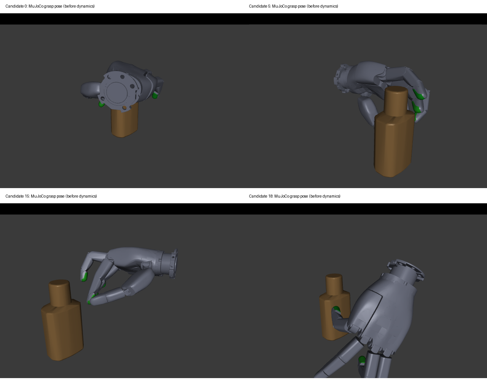

# Sharpa whole-distal object-contact trial

**Withdrawn at the user's request.** The experimental source configs and optional
contact-mask code have been removed; the original pad-only behavior is restored.
Recorded outputs and config snapshots remain under `benchmarks/sharpa_distal_contact`.
The synthesis commands below are historical and cannot be rerun on the restored
code without reinstating the experimental implementation. Preview of saved poses
still works.

This requested single-variable trial adds the five DP links to the object-contact
allowance, alongside the five elastomer pads. It did **not** improve grasp quality
on the smoke bottle: the new batch succeeds on 0/20, compared with 1/20 for the
recorded pad-only baseline. It remains an opt-in experiment, not a new default.

## Exact change

New BODex configuration files:

- `src/curobo/content/configs/manip/sim_sharpa_distal.yml`
- `src/curobo/content/configs/manip/sim_sharpa/tabletop_full_distal.yml`

The manipulation config differs from `tabletop_full.yml` by exactly one field:
`grasp_contact_strategy.contact_collision_link_names`, containing all five
`right_*_DP` and `right_*_elastomer` links. The optional field is read only when
constructing the primitive object-collision contact mask. Without it, the old
behavior is unchanged, including Shadow.

Actual mask verification found 149 contact-allowance spheres in the original
Sharpa config and 309 in the trial: exactly 160 DP spheres were added. The Shadow
default still selects its original 14 contact-allowance spheres. The verification
uses the real robot configuration and `ArmCostConfig` construction path; results
are saved in `contact_allowance_check.json` in the run directory.

The five grasp attraction targets and contact meshes remain the elastomer pads,
so the trial isolates whether DP avoidance opposes pad contact. It does not retarget
the optimizer toward arbitrary points on the entire distal segment. DP and pad
spheres use the contact-link distance schedule (final -2 mm), rather than DP using
the non-contact final +2 mm margin. This is a change to BODex's allowed object-contact
cost, not removal of its collision checks. Self-collision, all sphere geometry,
joint limits, soft bound costs, initialization, contact/force weights, and the
MuJoCo model/controller/evaluation thresholds remain unchanged.

## Results

One original bottle scene, scale 0.081, 20 candidates, surface initialization,
configured seed 123 and the same explicit trimesh seeding wrapper. Candidates were
rendered and inspected before evaluation. All 20 pregrasp/grasp poses are finite
and within limits; all 20 complete 750 physics steps without numerical warnings.

| Measure | Original pad-only | DP + pad allowance |
| --- | --- | --- |
| Attempted / evaluated | 20 / 20 | 20 / 20 |
| Physical lift success | 1 / 20 | 0 / 20 |
| BODex optimizer success flags | 0 / 20 | 0 / 20 |
| Cases with static grasp contacts | 10 / 20 | 12 / 20 |
| Median worst-finger contact-distance residual | 41.812 mm | 58.265 mm |
| All three stages within joint limits | 2 / 20 | 3 / 20 |
| Maximum squeeze target limit excess | 0.319254 rad | 0.366500 rad |
| Maximum dynamic hand-object penetration | 5.219 mm | 2.344 mm |
| Maximum dynamic self-penetration | 3.616 mm | 2.391 mm |
| Maximum static self-penetration | 8.167 mm | 0.243 mm |
| Numerical warnings | 0 | 0 |

The distance statistic takes the largest designated fingertip residual for each
candidate, then the median across 20 candidates. More cases with at least one
contact does not imply better five-finger contact or stable force closure.

This one batch does not prove DP allowance never matters, but it does not support
treating DP avoidance as the sufficient explanation or adopting this change as a
fix. Soft joint-limit penalties, sphere-cost scaling, initialization and contact
target convergence remain separate hypotheses. No further synthesis was launched
for this trial. Initial seed tensors were not retained by the existing solver
(`GraspResult.seed=None`), so the claim is matching seed/configuration, not a
bitwise-verified paired initial-state experiment.



## Artifacts and reproduction

Workspace run directory: `benchmarks/sharpa_distal_contact`. It contains pre-solve
config snapshots, resolved configs, raw solver results, original and converted
grasps, per-candidate evaluation and contact diagnostics, `comparison.json`,
`candidate_validation.json`, mask verification and logs.

```bash
export HUGS_DATASET_ROOT=/home/hao-fang/hugs-dataset
export SMOKE_DIAGNOSTIC_DIR=/home/hao-fang/hugs-workspace/benchmarks/sharpa_distal_contact
export HUGS_OUTPUT_ROOT="$SMOKE_DIAGNOSTIC_DIR/output"
cd /home/hao-fang/hugs-workspace/HUGS-BODex
.venv/bin/python scripts/run_sharpa_smoke.py task=synthesis name=sharpa_distal \
  manip_cfg_file=sim_sharpa/tabletop_full_distal.yml task.suite_config=sim_sharpa_distal.yml \
  'task.grasp_types=[3_right_full]' \
  task.scene_source.manifest_path=/home/hao-fang/hugs-workspace/benchmarks/sharpa_phase2_final/scenes.txt \
  task.parallel_world=1 n_worker=1

cd /home/hao-fang/hugs-workspace/HUGS-DexGraspBench
.venv/bin/python src/main.py task=format hand=sharpa_right exp_name=sharpa_distal_right_full \
  save_root="$SMOKE_DIAGNOSTIC_DIR/bench" task.data_name=BimanBODex \
  task.data_path="$HUGS_OUTPUT_ROOT/sim_sharpa/tabletop_full_distal/sharpa_distal/graspdata" n_worker=1
MUJOCO_GL=egl .venv/bin/python scripts/render_sharpa_smoke.py task=eval hand=sharpa_right \
  exp_name=sharpa_distal_right_full save_root="$SMOKE_DIAGNOSTIC_DIR/bench" n_worker=1
# Inspect the candidate image before evaluation.
MUJOCO_GL=egl .venv/bin/python scripts/evaluate_sharpa_smoke.py task=eval hand=sharpa_right \
  exp_name=sharpa_distal_right_full save_root="$SMOKE_DIAGNOSTIC_DIR/bench" \
  task.start=0 task.end=20 n_worker=1
```

Browser preview (forward client localhost:8082 to server 127.0.0.1:8082):

```bash
cd /home/hao-fang/hugs-workspace/HUGS-DexGraspBench
HUGS_DATASET_ROOT=/home/hao-fang/hugs-dataset \
.venv/bin/python scripts/preview_sharpa_poses.py task=eval hand=sharpa_right \
  exp_name=sharpa_distal_right_full \
  save_root=/home/hao-fang/hugs-workspace/benchmarks/sharpa_distal_contact/bench \
  task.viewer.port=8082 +preview_stage=grasp
```
