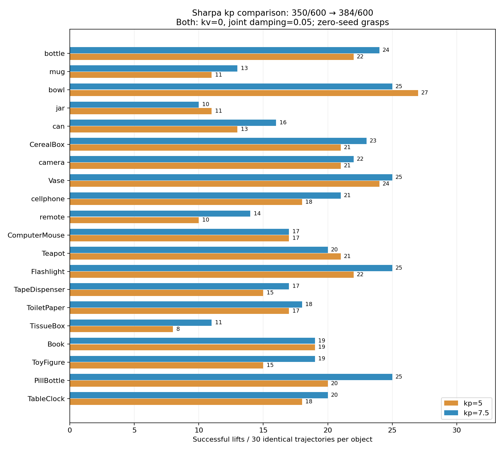

# Sharpa kp=7.5、kv=0、關節阻尼=0.05：600 組配對重播

**完成：抬升成功 350/600（58.3%）→384/600（64.0%），增加 34 次、5.7 個百分點。**
完全相同軌跡下，40 組失敗轉成功、6 組成功轉失敗、554 組不變。
20 類物件中 15 類改善、3 類下降、2 類持平。

本次只改實驗模型的 kp=5→7.5；actuator kv=0、joint damping=0.05、力矩上限、
幾何與評估條件保持相同。沿用全零初始關節生成的 600 組軌跡，不重新生成 grasp。
依使用者指示，正式右手設定已採用 kp=7.5／kv=0／damping=0.05；BODex 初始
22 關節仍全零。生成器已重建右手模型，編譯參數與本次測試模型比對一致。左手維持
kp=2／kv=0.05／damping=0，既有 hand_util.py 變更未納入提交。

## 整體結果

| 指標 | kp=5（已保存的配對基準） | kp=7.5（本次） |
|---|---:|---:|
| 抬升成功／全部候選 | 350/600（58.3%） | **384/600（64.0%）** |
| 成功且三階段目標合法／全部候選 | 295/600（49.2%） | **323/600（53.8%）** |
| 三階段目標皆合法的候選 | 469/600 | 469/600 |
| MuJoCo 警告／非有限狀態 | 0／0 | 0／0 |
| 初始嚴重穿透拒絕 | 0 | 0 |
| 曾達 actuator 力矩上限 99% 的候選 | 1/600 | 9/600 |
| 最大動態手物穿透 | 5.773 mm | 5.688 mm |
| 候選峰值手物穿透第 95 百分位 | 2.400 mm | 2.298 mm |
| 最大動態自碰撞穿透 | 7.277 mm | 8.623 mm |
| 最大實際軟限位超出量 | 0.037578 rad | 0.037184 rad |
| 最大 actuator 力矩絕對值（跨所有關節） | 1.037 N·m | 1.552 N·m |
| 最大關節速度絕對值 | 15.019 rad/s | 15.445 rad/s |
| lift 最後 200 ms 關節速度 RMS 的候選中位數 | 0.0315 rad/s | 0.0379 rad/s |

600 次新評估全部各跑完 750 steps，共 450,000 steps，4 個 CPU 程序約 62 秒。
kp=5 沿用先前逐候選結果與 traces，本次沒有重新跑完整 kp=5 評估。兩組皆重新
稽核 600 個輸入 SHA-256、評估與 trace 檔數、數值有限性、目標合法性及物體質量。
與小測試重疊的 60 個 kp=7.5 成敗結果也全部重現。

## 排除先前用來調參的 60 組

| 範圍 | kp=5 | kp=7.5 | 改善／退步 |
|---|---:|---:|---:|
| 先前小測試的 60 組 | 31/60 | 36/60 | 5／0 |
| **其餘 540 組** | **319/540（59.1%）** | **348/540（64.4%）** | **35／6** |

因此改善也出現在之前未用於這輪控制器篩選／確認的候選上。540 組仍來自同一個
20 物件資料集，包含部分相同物件及場景，不能當作完全未見物件的測試。

20 個物件群組 bootstrap 20,000 次（seed=20261101），保留每物件所有配對：
整體成功率改善的 95% 區間為 **+3.0 至 +8.2 個百分點**；「成功且目標合法／
全部候選」改善區間為 +2.5 至 +6.8 個百分點。完整 600 組含 60 組調參資料，
區間未校正模型選擇，也不代表任意物件／尺寸或硬體的成功率保證。

## 各物件結果

| 物件 | kp5 成功／30 | kp7.5 成功／30 | kp5 合法成功／30 | kp7.5 合法成功／30 |
|---|---:|---:|---:|---:|
| bottle | 22 | 24 | 21 | 22 |
| mug | 11 | 13 | 10 | 12 |
| bowl | 27 | 25 | 20 | 20 |
| jar | 11 | 10 | 9 | 8 |
| can | 13 | 16 | 9 | 12 |
| CerealBox | 21 | 23 | 18 | 20 |
| camera | 21 | 22 | 18 | 19 |
| Vase | 24 | 25 | 21 | 22 |
| cellphone | 18 | 21 | 14 | 16 |
| remote | 10 | 14 | 8 | 11 |
| ComputerMouse | 17 | 17 | 14 | 14 |
| Teapot | 21 | 20 | 20 | 19 |
| Flashlight | 22 | 25 | 19 | 21 |
| TapeDispenser | 15 | 17 | 12 | 13 |
| ToiletPaper | 17 | 18 | 15 | 15 |
| TissueBox | 8 | 11 | 6 | 9 |
| Book | 19 | 19 | 17 | 17 |
| ToyFigure | 15 | 19 | 9 | 12 |
| PillBottle | 20 | 25 | 19 | 24 |
| TableClock | 18 | 20 | 16 | 17 |



## 退步與限制

kp=7.5 的整體改善獲得較大樣本支持，但不是所有抓取都改善。6 個退步案例分布於
bowl 3 個、jar 1 個、Teapot 1 個、Book 1 個；Book 同時有另一個改善，總數持平。
其中 2 個 bowl 案例位置誤差仍小於 5 cm，但角度誤差超過 15°門檻；另外 4 個
位置誤差約 10 cm。詳細 scene、candidate、位置／角度誤差、飽和與穿透見
`regressions.json`。這些是失敗判定觀察，尚未單獨證明失敗的接觸動力學原因。

相較小測試，這批完整資料的手物穿透最大值與第 95 百分位反而略低；但自碰撞峰值
與飽和候選增加。9/600（1.5%）曾達 99% 力矩上限，並非這 9 次全程持續飽和。
跨關節的最大力矩不可當作每個關節或 DIP 的輸出；原本每關節 force limit 保留。
61 個 kp=7.5 成功候選有至少一階段目標超限，因此不能把 384 次都當成合法姿態成功。

穿透量來自 MuJoCo collision proxy，不是精確 CAD 交集。力與接觸量從 mj_step
後的求解快取讀取。每類只有一個物件實例，scale 固定 0.081。沒有新增 Shadow
評估；已知同場景歷史 Shadow 為 476/600（79.3%），是各自生成 grasp 的參考。

## 重現與檔案

本目錄提交報告、比較圖、彙總、模型驗證與退步案例。下述腳本、模型、完整逐步
資料與輸入雜湊留在 workspace 的 `reviews/sharpa_kp7p5_600/`，不在本次 commit。
實驗腳本的正式檔案雜湊保護仍指向測試前 kp=5 狀態；正式採用 kp=7.5 後，
若要重新執行須在獨立實驗目錄更新該檢查，不能直接覆寫舊基準。

從 workspace 根目錄執行：

```bash
HUGS-DexGraspBench/.venv/bin/python reviews/sharpa_kp7p5_600/run.py
HUGS-DexGraspBench/.venv/bin/python reviews/sharpa_kp7p5_600/summarize.py
```

- `models/kp7p5.xml`：與小測試相同的實驗模型。
- `model_verification.json`：與 kp=5 比較的編譯陣列不變項及模型 SHA-256。
- `prepared.json`：60 個場景與 600 個輸入的雜湊，所有初始關節為零。
- `summary.json`／`per_category.csv`／`pairs.json`：整體、逐物件、逐候選配對結果。
- `results/<category>/poseN/kp7p5/`：新評估、逐步 traces 與控制輸出。
- `regressions.json`：6 個成功轉失敗案例。
- `active_file_hashes.json`：正式設定與既有 hand_util.py 在測試前後未改動的檢查。

腳本可重用完成結果續跑；要重新實驗應使用新輸出目錄。kp=5 對照原始資料保留在
`reviews/sharpa_control_expanded/`，小測試紀錄在 `reviews/sharpa_controller_tuning_small/`。
