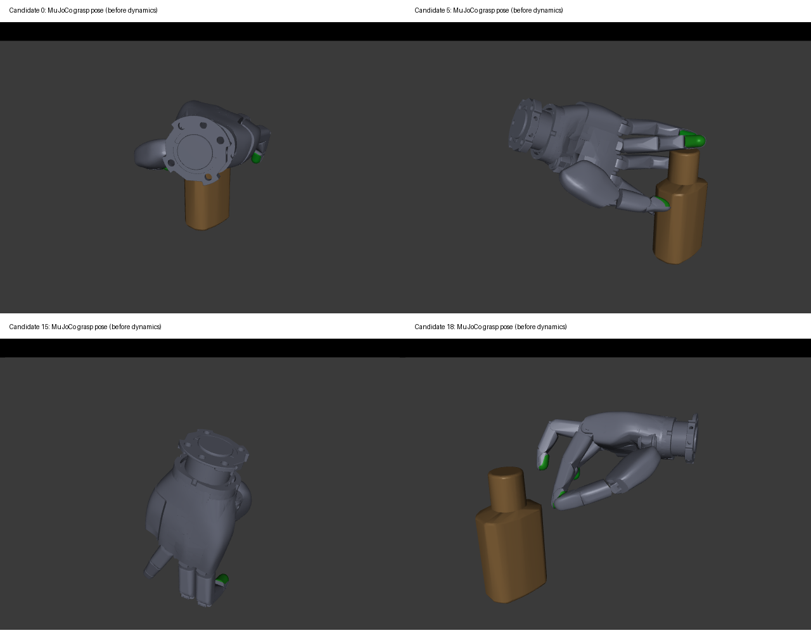

# Sharpa Phase 2: BODex → MuJoCo smoke results

**The minimum end-to-end acceptance criterion passed.** A real BODex candidate
was generated, converted by the existing BimanBODex formatter, and evaluated by
the unchanged Shadow `right_full` tabletop evaluator. The final batch contains
one physically successful grasp. This preset is **not ready for large-scale
generation or unrestricted grasp evaluation**.

## Final recorded batch

One DGN_2k bottle (`core_bottle_1071fa4cddb2da2fc8724d5673a063a6`), scene
`scale008_pose004_0`, actual scale 0.081. Right hand only, 20 candidates,
surface initialization, seed 123. Output: `benchmarks/sharpa_phase2_final` in the
workspace. All candidates were visualized before evaluation.

| Measure | Result |
| --- | --- |
| Attempted / optimizer completed | 20 / 20 |
| BODex optimizer success flag | 0 / 20 |
| Converted / evaluated | 20 / 20 |
| Finite, normalized, in-limit pregrasp and grasp | 20 / 20 |
| All three stages in joint limits | 2 / 20 (IDs 5 and 12) |
| MuJoCo grasp success | 1 / 20 (ID 5) |
| Cases with dynamic hand-object contact | 15 / 20 |
| Numerical warning counts | 0 |
| Physics steps per candidate | 750 |
| Maximum dynamic hand-object penetration | 5.219 mm |
| Maximum dynamic self-penetration | 3.616 mm |
| Maximum static grasp-pose self-penetration | 8.167 mm |

Candidate 5, the successful case, has all three targets inside joint limits. It
moved the object 93.804 mm, with 6.654 mm error relative to the prescribed 100 mm
lift, and 5.881 degrees rotation error. Its maximum dynamic hand-object penetration
was 0.799 mm; static and dynamic self-penetration metrics were zero. It passes the
existing 50 mm translation-error / 15 degree rotation-error thresholds. The
optimizer's success flag remains false; optimizer success and physical simulation
success are different measures and are not relabeled.

## Validity and remaining failures

The formatter preserves canonical thumb-first 22-joint names and flange-root wxyz
poses. The evaluator reorders by names as usual. No new conversion logic or Shadow
evaluator changes were necessary.

The existing BODex output rule extrapolates squeeze joints as
`2 * grasp - pregrasp`, keeping the grasp root. In 18 final candidates this command
exceeds URDF limits, by up to 0.319254 rad. Those targets were not silently clipped.
All 20 were evaluated as diagnostic, loadable candidates under the existing
controller semantics; **only 2 are strictly valid across all three stages**.
Thus the aspirational target of 10–20 fully in-limit candidates was not achieved.
The minimum acceptance criterion is met, including a successful fully valid case,
but all-stage validity and generation quality remain explicit blockers.

Several poses do not enclose the object or develop sufficient opposing finger
contacts. Zero optimizer success, residual self-contacts, and coverage gaps prevent
claiming calibration. The existing force objective was preserved; these results
do not identify a single exclusive cause of optimizer failure. Use the saved
grasp/dist errors, contacts and trajectories for subsequent calibration.

The Phase 1 convex-mesh limitations remain visible: `middle_DP/ring_MP` and
`ring_DP/pinky_MP` can produce artifacts at large MCP abduction. Contact JSON records
geom/body pairs, contact positions/normals and penetration. No new geometric
intersection classification was performed for each optimized pose, so the static
self-penetration values must not automatically be called genuine mesh overlap or
attributed entirely to those two known artifacts.

## Collision and frame validation

The final BODex model has 998 spheres generated from Sharpa collision meshes.
Zero-pose retained sphere pairs have **no overlap**. Exclusions cover only welded
rigid groups and direct adjacent rigid bodies; palm/thumb and cross-finger pairs
remain enabled. The geometric policy, transfer equations and full implementation
map are in `../../HUGS-BODex/docs/sharpa_phase2.md`.

Measured independent maximum surface gaps are 4.503 mm at the wrist, 2.698 mm at
the palm, 2.625 mm at pinky MC, and 2.602 mm at thumb DP. The nominal 1.5 mm gap
target is therefore not universally met. Maximum sampled *outside* sphere error
on watertight meshes is 1.012 mm. Open MP/DP meshes do not have a certified signed
outside metric. These are sampled geometric checks, not full-volume guarantees.
The slower cuRobo self-collision kernel is selected because of the sphere count.

CUDA FK matches independent URDF FK over 12 random world/joint poses with maximum
matrix-element error `4.92e-7`. The actual human-prior seed builder passes 12 known
world transforms (translation error `3.40e-8` m; rotation-matrix error `1.40e-7`).
Human testing uses synthetic records to validate the mapping, not a learned prior
or human joint retargeting. Canonical URDF kinematics and order are unchanged;
the temporary -10 degree thumb hold workaround is not used.

Two independent final sphere builds produce the same SHA256:
`8219ba01bd683d1d10f9fa62d2e0df8edde4ca04961d7dfa8092a5f8fd40d6b4`.
Final synthesis configs were snapshotted before optimization. No MuJoCo MJCF,
controller gain, friction, force, success or penetration threshold was changed
for this phase. The four existing single-hand formatter regression tests pass.

## Experiment accounting

There were **three small runs of 20 candidates: 60 attempted and 60 unique
evaluations total**, all on the same single scene. No large-scale synthesis or
training was launched. These correlated engineering trials are not a success-rate
benchmark across objects.

| Run directory | Reason | Optimizer success | Physical success |
| --- | --- | --- | --- |
| `benchmarks/sharpa_phase2` | Initial enclosing-cluster sphere prototype; rejected for false zero-pose overlaps up to 19.5 mm | 0/20 | 0/20 |
| `benchmarks/sharpa_phase2_refined` | Interior-distance sphere refinement; discovered unseeded trimesh sampling | 0/20 | 1/20 |
| `benchmarks/sharpa_phase2_final` | Explicit trimesh seeds, reproducible spheres, pre-solve config snapshots | 0/20 | 1/20 |

The initial batch was evaluated twice to improve unnamed-geom diagnostic logging;
this replay is not counted as new candidates. Earlier runs used OS-entropy mesh
sampling despite fixed NumPy seeds and are exploratory records. The refined run's
post-run configuration hash is not a valid provenance claim for its synthesis;
only the final snapshot/hash is authoritative. Retained raw outputs still allow
replaying the earlier MuJoCo evaluations. The final run alone is the delivery
baseline; its physical success is not inflated by selecting the earlier run.

## Artifacts and next gate

- `docs/sharpa_phase2_validation.json`: final per-candidate metrics and config hashes.
- `docs/sharpa_validation.json`: Phase 1 retained with a Phase 2 summary added.
- `docs/sharpa_phase2_commands.md`: exact synthesis, visualization, conversion,
  diagnostic evaluation and regression commands.
- Final run directory: raw solver NPZ and NPY, converted/evaluated grasps, resolved
  configs, config snapshots, logs, and per-step contact/object diagnostics.
- BODex `docs/sharpa_sphere_validation.json`, `sharpa_synthesis_validation.json`
  and `sharpa_sphere_reproducibility.json`: geometric, GPU/frame and hash checks.

Before scaling: improve coverage efficiently while preserving the absence of
false zero-pose collisions; calibrate Sharpa contact initialization and the force
objective; establish an explicit bounded squeeze-generation policy in a separate
change; then obtain 10–20 all-stage-valid grasps across additional controlled
objects. Keep the established Shadow evaluator unchanged. Hardware, DexLearn
training and additional dataset synthesis remain outside this milestone.
